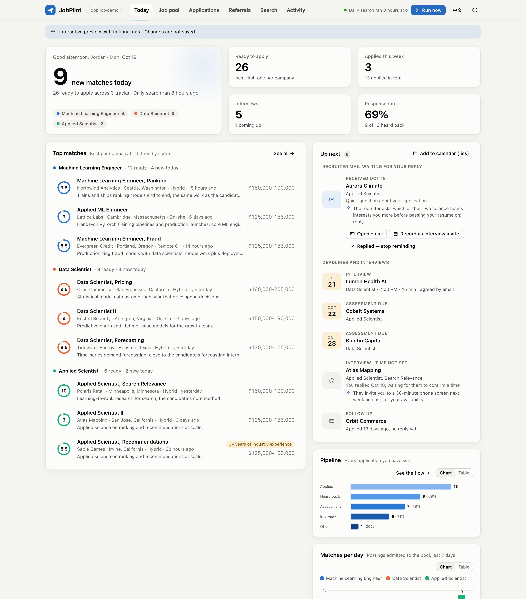
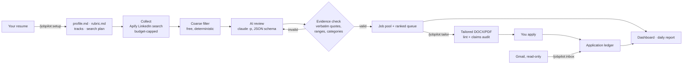

<div align="center">

# JobPilot

**Your AI job-search copilot for Claude Code.**
Upload your resume once. Every morning JobPilot finds the roles that fit you, explains every score with evidence,
tailors your resume without inventing a word, and keeps your whole pipeline on one local dashboard.

[English](README.md) · [简体中文](README.zh-CN.md) · [Docs](docs/) · [Live demo](#try-it-in-two-minutes-no-accounts-needed)



</div>

## Why

Job boards show you hundreds of postings; most are the wrong level, the wrong field, need a citizenship you don't
have, or are AI-training gigs dressed up as "research". Applying well takes a tailored resume for each one, and
keeping track of assessments, interviews and follow-ups is a job in itself.

JobPilot does the tedious parts and leaves the decisions — and the submit button — to you:

- **Resume in, search plan out.** `/jobpilot:setup resume.pdf` reads your resume, proposes role tracks you are
  actually qualified for, writes a scoring rubric per track and designs a LinkedIn search plan (Apify) — then checks
  that plan offline against example titles before it costs a cent.
- **A daily shortlist, not a firehose.** Each day it collects new postings under hard budget caps, drops what you can
  never take for free (internships, citizenship-only roles, "no sponsorship" if you need it, salary floors, gig
  platforms), and has Claude review the rest in batches. Roles paying less than your target (but above the floor)
  can stay in as labeled practice roles for interview practice, queued after the rest.
- **Scores you can audit.** Every score is four components (duties, background, skills, seniority) with **verbatim
  quotes** from the job description and from your profile. JobPilot's code checks each quote really exists and
  rejects the review if it doesn't. No hallucinated "great fit".
- **Truthful tailoring.** `/jobpilot:tailor <id>` makes minimal edits to *your own* Word resume (formatting
  preserved byte for byte), mirrors the posting's keywords only where they are true, lints for claims you must never
  make, and runs an independent claims audit. It asks you questions instead of filling gaps with fiction.
- **Your pipeline, tracked.** Applications, assessments with deadlines, interviews, offers and rejections live in an
  append-only ledger. `/jobpilot:inbox` reads (only reads) your Gmail like a secretary: whole threads, your own
  replies included, a one-line summary and the next step for every email, an interview time both sides agreed
  written straight onto the interview, and a recruiter's question kept on Today until you answer it. Interviews and
  assessment deadlines also land in an `.ics` file for your calendar app (`jobpilot app ics`, or "Add to calendar"
  on the dashboard).
- **Referrals.** `/jobpilot:referrals <company>` finds alumni of your schools at a company, ranks who is most likely
  to help, and drafts short personal notes and a cold email (with a one-click Gmail draft) — which you send
  yourself.
- **A calm local dashboard.** Today's matches, the pool with score breakdowns, a kanban of your applications,
  referrals, spend and activity — in English or 中文, light or dark, on your laptop or phone.

## How it works



A deterministic core (plain Python, standard library only) does everything that must be exact: paid searches under
caps, filtering, evidence checks, the pool, the ledger and the dashboard. The judgment calls go to **one-shot**
Claude runs with no tools whose answers must fit a JSON schema — or to the Claude Code session you're working in.
There is no long-lived agent accumulating context, and every handoff is a file you can read.

## Try it in two minutes (no accounts needed)

```bash
git clone https://github.com/ZhengShixin/JobPilot && cd JobPilot
plugins/jobpilot/bin/jobpilot demo ~/jobpilot-demo     # fictional candidate, postings and applications
cd ~/jobpilot-demo && ./jobpilot dashboard             # opens http://127.0.0.1:8765
```

## Install

Requirements: [Claude Code](https://claude.com/claude-code) (a Claude subscription or API key), Python 3.11+,
an [Apify](https://apify.com) account (the free plan works for a focused search). Optional: LibreOffice (PDF export
of tailored resumes), the Gmail connector in Claude (inbox tracking).

In Claude Code:

```text
/plugin marketplace add ZhengShixin/JobPilot
/plugin install jobpilot@jobpilot
```

Then, in a new folder for your search:

```bash
mkdir ~/job-search && cd ~/job-search && claude
```

```text
/jobpilot:setup ~/Downloads/my-resume.pdf
```

Setup asks a few questions only you can answer (work authorization, level, locations, budget, which tracks), writes
everything into the folder and checks the plan. Save your Apify token **in your own terminal** — it never enters the
chat:

```bash
./jobpilot token set
```

Then run the first search (`/jobpilot:daily`), open the dashboard (`/jobpilot:dashboard`) and turn on the daily run
(`/jobpilot:schedule`).

<details>
<summary>Without the plugin (CLI only)</summary>

```bash
pipx install git+https://github.com/ZhengShixin/JobPilot
jobpilot init ~/job-search && cd ~/job-search
```

The CLI runs collection, review (through `claude -p`), the ledger and the dashboard on its own; the guided setup and
tailoring conversations are Claude Code skills.
</details>

## Commands

| In Claude Code | What it does |
|---|---|
| `/jobpilot:setup <resume>` | resume → facts, tracks, rubrics, search plan, offline check |
| `/jobpilot:daily` | search now → filter → AI review → daily report |
| `/jobpilot:jobs` | walk through the best matches and decide |
| `/jobpilot:tailor <id>` | truthful tailored resume (+ cover letter) with lint and claims audit |
| `/jobpilot:track <update>` | "got an OA from Acme due Friday" → ledger |
| `/jobpilot:inbox` | read Gmail for application updates and record them |
| `/jobpilot:referrals <company>` | alumni at a company + draft notes you send |
| `/jobpilot:dashboard` | open the local dashboard |
| `/jobpilot:tune` | fix missed roles, noise or scoring from real results |
| `/jobpilot:schedule` | daily automation (macOS LaunchAgent / Linux cron) |
| `/jobpilot:help` | everything else |

Every step is also a CLI command (`jobpilot queue`, `jobpilot app event A007 interview_scheduled --time
2026-11-03T14:00`, `jobpilot plan check`, …) — see [docs/cli.md](docs/cli.md).

## Costs

- **Apify** (your account): about $0.005 per posting on the free tier ($0.0015–0.0035 on paid tiers). A focused plan
  returning ~80 postings a day costs about $0.40/day. Every run has a hard cap (`maxTotalChargeUsd`), and JobPilot
  enforces a daily and a monthly budget on top; `jobpilot pause` stops all paid runs.
- **Claude**: reviews run on your Claude Code plan (Sonnet by default). One batch of ~10 job descriptions averages
  about $0.20 at API prices; the free coarse filter removes a large share of postings (about 40% in the author's
  own search) before any AI sees them.

## Privacy and safety

- **Local first.** Your workspace folder holds everything. Job descriptions and your scoring profile go to Claude for
  review; search filters go to Apify. Nothing else leaves your machine.
- **You stay in control.** JobPilot never submits an application, never sends an email or a LinkedIn message, and
  never logs in anywhere for you. A guard hook enforces this inside your workspace.
- **Secrets stay secret.** The Apify token is read by the CLI only; the guard blocks the AI from reading it.
- **No fabrication.** Facts come only from your `profile.md`; claims you must never make are linted.
- **Prompt-injection aware.** Job descriptions, emails and profiles are wrapped as untrusted data; a posting that
  tries to instruct the AI is held for you to check.
- **Referrals note.** The alumni finder uses a third-party Apify actor that collects public LinkedIn profile data;
  LinkedIn's terms restrict scraping. It is off until you use it, and people's data stays local.

More in [docs/privacy.md](docs/privacy.md).

## Design highlights

- Evidence-bound scoring: the model proposes, code verifies (verbatim quotes, ranges, per-track categories, fit caps)
  and computes the score; scores are keyed to the rubric's hash and go stale when you edit it.
- Budget-safe paid calls: input keys checked against the actor's schema before paying, per-run caps, no POST
  retries, uncertain launches reconciled by start time, daily pacing of the monthly budget.
- An offline emulator of the job search's matching semantics (PostgreSQL "simple" full-text search, inferred from
  50,000+ real results) so plans are tested for free.
- A standard-library DOCX engine that edits your resume's text in place without re-serializing the document.
- Append-only, hash-chained ledgers; derived state, never stored state.
- Offline test suite (no accounts needed): `python3 -m unittest discover -s tests`.

## Roadmap

More job sources (company career sites, other boards) · interview-prep packs per posting · multi-language resumes ·
a hosted read-only dashboard view. Issues and pull requests are welcome.

## About

JobPilot is the open-source, generalized version of the system I built for my own job search and use every day.
I'm **Shixin Zheng**, currently looking for **Quant Researcher, Research Scientist and ML Engineer** roles —
referrals and introductions are very welcome.
[Website](https://shixin-zheng.github.io) · [LinkedIn](https://www.linkedin.com/in/shixinzheng/)

MIT License.
