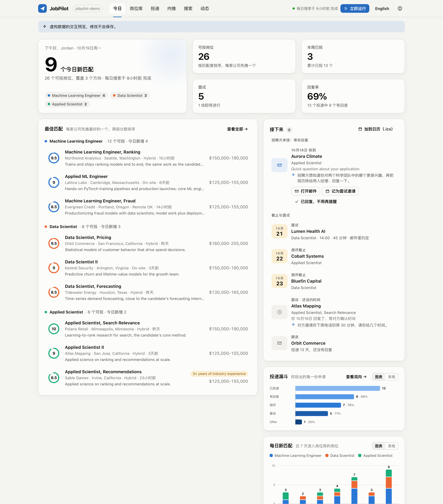
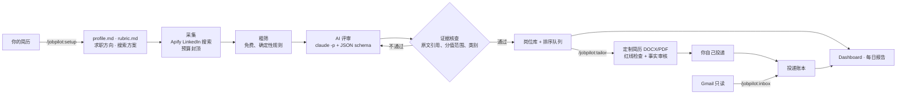

<div align="center">

# JobPilot

**跑在 Claude Code 里的 AI 求职秘书。**
上传一次简历，之后它每天早上替你找到真正匹配的岗位，每个分数都附原文证据；定制简历不编一个字；
整个投递进度集中在一个本地 dashboard 上。

[English](README.md) · [简体中文](README.zh-CN.md) · [文档](docs/) · [两分钟试用](#两分钟试用不需要任何账号)



</div>

## 为什么做这个

招聘网站一刷几百条，大部分是级别不对、方向不对、要求美国公民，或者是包装成"研究员"的 AI 数据标注零工。
想投好一个岗位，还得为它改一版简历；测评截止日、面试时间、该不该跟进，光记这些就够累的。

JobPilot 把繁琐的部分做完，决定权和"提交"按钮都留给你自己：

- **简历进，搜索方案出。** `/jobpilot:setup 简历.pdf` 读你的简历，根据你真实的背景推荐求职方向（track），
  为每个方向写一套打分标准，再设计 LinkedIn 搜索方案（通过 Apify）。花钱之前，先用示例岗位标题离线验证一遍，
  确认搜得到、不乱搜。
- **每天一份短名单，不是信息洪流。** 每天在预算上限内抓新岗位；你一定投不了的岗位先用免费的确定性规则筛掉
  （实习、只招美国公民、你需要 sponsor 但对方明确不提供、薪资低于底线、AI 标注零工平台），剩下的再交给 Claude
  分批评审。
- **分数可以核查。** 每个分数由四项组成（职责、背景、技能、资历），每项都要引用 JD 原文和你个人资料的原文。
  代码会逐条核对引文是否真的存在，对不上就整条作废。不会出现凭空的"非常匹配"。
- **定制简历不造假。** `/jobpilot:tailor <编号>` 在你自己的 Word 简历上做最小改动，格式一个字节都不动；
  只在属实的地方使用 JD 里的关键词；检查你设定的"绝不能写"的说法；最后再由一个独立的审核员逐句查证据。
  缺事实的时候它会问你，而不是自己编。
- **投递进度自动记账。** 投递、测评（含截止日）、面试、offer、拒信都记在只追加的账本里。
  `/jobpilot:inbox` 像秘书一样只读你的 Gmail：整串邮件连同你自己的回复一起读，每封邮件给一两句摘要和下一步；
  双方在邮件里约定的面试时间直接记到面试上；招聘方问你的问题一直留在「今日」，直到你回复。
- **找校友内推。** `/jobpilot:referrals <公司>` 找出这家公司里和你同校的人，排出谁最可能帮你，
  帮你写好加好友附言和后续消息，由你自己发送。
- **安静好看的本地 dashboard。** 今日匹配、带打分明细的岗位库、投递看板、内推、花费和动态；
  中英文切换、深浅色，电脑和手机都能看。

## 工作流程



必须精确的事情都由确定性的代码完成（纯 Python 标准库）：付费搜索的预算封顶、筛选、证据核查、岗位库、账本和
dashboard。需要判断力的事情交给**一次性**的 Claude 调用：没有任何工具，回答必须符合 JSON schema；或者交给你
正在用的 Claude Code 会话。没有一个长期运行、越积越多上下文的 agent，每一步交接都是你能打开看的文件。

## 两分钟试用（不需要任何账号）

```bash
git clone https://github.com/ZhengShixin/JobPilot && cd JobPilot
plugins/jobpilot/bin/jobpilot demo ~/jobpilot-demo --lang zh   # 虚构的求职者、岗位和投递记录
cd ~/jobpilot-demo && ./jobpilot dashboard                     # 打开 http://127.0.0.1:8765
```

## 安装

需要：[Claude Code](https://claude.com/claude-code)（Claude 订阅或 API key）、Python 3.11+、
一个 [Apify](https://apify.com) 账号（搜索范围不大的话免费额度就够）。可选：LibreOffice（把定制简历导出成 PDF）、
Claude 里连接 Gmail（自动追踪进度）。

在 Claude Code 里：

```text
/plugin marketplace add ZhengShixin/JobPilot
/plugin install jobpilot@jobpilot
```

然后为求职新建一个文件夹：

```bash
mkdir ~/job-search && cd ~/job-search && claude
```

```text
/jobpilot:setup ~/Downloads/我的简历.pdf
```

setup 只会问几个必须由你决定的问题（工作身份、目标级别、地点、预算、选哪些方向），然后把所有文件写进这个文件夹
并验证搜索方案。Apify token 请**在你自己的终端里**保存，它永远不会出现在对话里：

```bash
./jobpilot token set
```

接着跑第一次搜索（`/jobpilot:daily`），打开 dashboard（`/jobpilot:dashboard`），再打开每日自动运行
（`/jobpilot:schedule`）。

<details>
<summary>不用插件，只用命令行</summary>

```bash
pipx install git+https://github.com/ZhengShixin/JobPilot
jobpilot init ~/job-search && cd ~/job-search
```

采集、评审（通过 `claude -p`）、账本和 dashboard 命令行都能单独跑；引导式的 setup 和定制简历是 Claude Code 的 skill。
</details>

## 命令

| Claude Code 里 | 作用 |
|---|---|
| `/jobpilot:setup <简历>` | 简历 → 事实、方向、打分标准、搜索方案、离线验证 |
| `/jobpilot:daily` | 立刻搜索 → 粗筛 → AI 评审 → 每日报告 |
| `/jobpilot:jobs` | 一起过一遍最匹配的岗位，决定投哪些 |
| `/jobpilot:tailor <编号>` | 不造假的定制简历（可附求职信），含红线检查和事实审核 |
| `/jobpilot:track <进展>` | "Acme 发了 OA，周五截止" → 记进账本 |
| `/jobpilot:inbox` | 读 Gmail 里的投递进展并记账 |
| `/jobpilot:referrals <公司>` | 找这家公司的校友，起草由你发送的附言 |
| `/jobpilot:dashboard` | 打开本地 dashboard |
| `/jobpilot:tune` | 根据真实结果修正漏搜、噪声和打分 |
| `/jobpilot:schedule` | 每日自动运行（macOS LaunchAgent / Linux cron） |
| `/jobpilot:help` | 其他一切 |

每一步也都有对应的命令行（`jobpilot queue`、`jobpilot app event A007 interview_scheduled --time
2026-11-03T14:00`、`jobpilot plan check` …），见 [docs/cli.md](docs/cli.md)。

## 费用

- **Apify**（你自己的账号）：免费档每条岗位约 $0.005（付费档 $0.0015–0.0035）。一个每天返回约 80 条岗位的精准
  方案，每天约 $0.40。每次运行都有硬上限（`maxTotalChargeUsd`），JobPilot 还在上面加了每日和每月预算；
  `jobpilot pause` 一键停止所有付费运行。
- **Claude**：评审用你的 Claude Code 额度（默认 Sonnet）。一批约 10 份 JD 按 API 价格平均约 $0.20；
  免费粗筛会先去掉一大部分岗位（作者自己的搜索里约 40%），AI 根本不用看。

## 隐私与安全

- **本地优先。** 所有数据都在你的工作区文件夹里。JD 和你的打分资料会发给 Claude 评审，搜索条件发给 Apify，
  除此之外什么都不出你的电脑。
- **你说了算。** JobPilot 从不提交申请、从不发邮件或 LinkedIn 消息、从不替你登录任何网站。工作区里有守卫 hook
  强制执行这一点。
- **密钥不外露。** Apify token 只有命令行程序自己读，守卫会拦住 AI 去读它。
- **不编造。** 关于你的事实只来自 `profile.md`；"绝不能写"的说法会被自动检查。
- **防提示注入。** JD、邮件、个人主页都作为不可信数据包起来；试图给 AI 下指令的岗位会被暂缓，等你人工看。
- **关于内推功能。** 校友查找用的是第三方 Apify actor，采集的是 LinkedIn 公开资料，而 LinkedIn 的条款限制抓取。
  你不主动用它就不会运行，查到的人员数据只留在本地。

详见 [docs/privacy.md](docs/privacy.md)。

## 设计亮点

- 证据约束的打分：模型提出，代码核查（原文引用、分值范围、每个方向自己的类别、封顶规则）并计算分数；
  分数绑定打分标准的哈希，改了标准，旧分数自动标记为过期。
- 付费调用安全：付钱之前先用 actor 的输入 schema 校验所有参数；每次运行单独封顶；POST 从不重试；
  结果不确定的启动按开始时间认领；月预算按天均摊。
- 离线模拟搜索的匹配规则（PostgreSQL "simple" 全文检索，从 5 万多条真实返回结果推断得出），
  改搜索方案不花一分钱就能验证。
- 纯标准库的 DOCX 引擎：直接在原文档里改文字，不重新序列化整个文档。
- 只追加、带哈希链的账本；状态全部由事件推导，不单独存储。
- 完全离线的测试（不需要任何账号）：`python3 -m unittest discover -s tests`。

## 路线图

更多岗位来源（公司官网、其他招聘网站）· 按岗位生成面试准备包 · 多语言简历 · 托管的只读 dashboard。
欢迎提 issue 和 PR。

## 关于作者

JobPilot 是我为自己的求职搭建、每天都在用的系统的开源通用版。我是 **Shixin Zheng**，正在找
**Quant Researcher、Research Scientist、ML Engineer** 方向的工作，非常欢迎内推和引荐！
[个人网站](https://shixin-zheng.github.io) · [LinkedIn](https://www.linkedin.com/in/shixinzheng/)

MIT 许可证。
